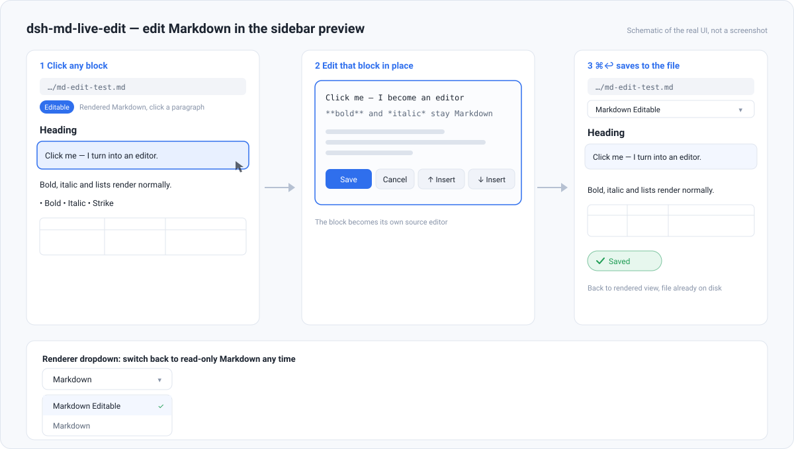

# @fanfan4589/dsh-md-live-edit

[](https://www.npmjs.com/package/@fanfan4589/dsh-md-live-edit)
[](./LICENSE)
[](./test)

English | [中文](README.zh.md)

Edit Markdown files **directly in the sidebar preview**: click any rendered block,
edit that block's Markdown source in place, and save the whole document back to
disk. No code mode, no separate editor.



> **Scope: a small, restrained patch.** It adds one preview implementation and
> one write route. It does not replace built-in slots or layout, does not change
> kernel behaviour, and does not touch other plugins' data. Turning it off
> returns the sidebar to the official read-only preview.

## What it solves

The built-in sidebar preview is view-only (`dsh-client-ui-sidebar-documentpreview`
documents "Preview, not editing"). To change a word you had to leave the rendered
view, find a text editor, and lose the context of the surrounding document.

This plugin registers an `extension`-band Markdown preview with the same
extensions (`md`, `markdown`). It ranks above the built-in renderer and is
selected by default; the renderer dropdown still offers the built-in read-only
**Markdown**, **Code**, and **Plain text** views at any time.

## How to use

1. Open any `.md` file in the right Sidebar (file tree, or `Mod+P` → files page).
2. The document renders as blocks. The header shows the **Markdown 可编辑 /
   Editable Markdown** renderer, and the body carries a green **可编辑** chip.
3. **Click a block** → it becomes a small editor holding that block's exact
   Markdown source. Everything else stays rendered.
4. Press `⌘/Ctrl + Enter` (or click **Save**) to write the document back.
   `Esc` / **Cancel** discards the edit for that block.
5. The editor toolbar also inserts a block above or below, and deletes the block
   (an emptied block is deleted; a deletion collapses the blank line it leaves).
   A **+ Add block** affordance sits at the end of the document.
6. The header reports save state: saving / saved / failed (with retry). If the
   file changes elsewhere while you edit, a conflict banner lets you reload the
   disk version or keep yours.

Frontmatter (`---` blocks) is editable like any other block.

### Editing a table

A table block opens as its own Markdown table. Add a row by adding one line:

```markdown
| Capability | Status | Note |
| --- | --- | --- |
| In-place edit | ✅ | click any block |
| Save | ✅ | ⌘↩ |
```

Save, and the rendered table updates.

## Advantages

- **Stay in the rendered view.** No mode switch, no full-document source view.
- **Source fidelity.** Every block keeps its exact source lines; editing one
  block rebuilds the file byte-for-byte around it, so untouched formatting,
  frontmatter, and spacing survive.
- **Whole-document safety.** Large files are completed page by page before
  editing is allowed, so a save can never write back only the first page.
- **Sandbox respected.** Writes go through the composed `fs` with the session's
  own policy (`sandboxPolicy.resolve({ session })`); a `read-only` session is
  refused rather than widened.
- **Admission-gated route.** The write route asks
  `connection.requestRejection` (Host/Origin fence + browser session) before it
  reads a body; a rejected request touches neither the body nor the filesystem.
- **Matches the host.** Theme tokens only; bilingual (English / 中文); follows
  `ctx.locale` and switches live.

## Limitations (honest)

- **Block source editing, not rich text.** You edit the block's Markdown source
  (a table opens as a table). It is not a Word/Excel-style direct surface; there
  is no cell-by-cell table editing.
- **No new files, no renames.** It edits the open file only; creating files and
  renaming stay in the files panel.
- **Rendering is a deliberate subset.** ATX/Setext headings, fenced code, GFM
  tables, lists, blockquotes, rules, frontmatter; inline bold/italic/strike/code/
  links/images. Nested lists render at one level, and math or nested-quote
  styling is not rendered — the source is still intact and editable.
- **Whole-file writes.** A save rewrites the file; concurrent external writes are
  detected while you edit and surfaced as a conflict, but there is no per-line
  patch transport.
- **Version floor.** Requires DSH `>=0.2.2-rc.1` (the release line whose
  `connection` service exposes `requestRejection`). On an older Host the route
  fails closed with `401` rather than serving an unguarded write.
- **Save mode follows the session.** In `read-only` sessions the preview is
  editable locally but the save is refused with the sandbox reason.

## Capability matrix

| Area | Supported |
| --- | --- |
| File types | `.md`, `.markdown` |
| Block editing | headings, paragraphs, lists, blockquotes, fenced code, tables, rules, frontmatter |
| Inline rendering | bold, italic, strikethrough, inline code, links, images |
| Block actions | edit, delete, insert above, insert below, append at end |
| Save | `⌘/Ctrl+Enter`, Save button; whole document |
| Conflict handling | external-change banner, reload or keep |
| Renderer | default; dropdown switches to built-in Markdown / Code / Plain text |
| Locales | English, 中文 |

## Install

### Add the local directory

```bash
git clone https://github.com/feifandiv/dsh-md-live-edit.git
```

Then add it as a bundle in DSH (Settings → Plugins → add/clone the directory, or
`plugin_manager` with `install_bundle` and the absolute package path). The
bundle row is `md-live-edit`.

### From npm

```bash
npm pack @fanfan4589/dsh-md-live-edit
tar -xzf fanfan4589-dsh-md-live-edit-*.tgz
# add the extracted package directory as a bundle in DSH
```

## Development

```bash
npm test        # node --test test/*.test.mjs — 34 cases
```

| Path | Responsibility |
| --- | --- |
| `index.js` | Host half: the admission-gated `POST /dsh-md-live-edit/api/write` route |
| `client.js` | Client half: preview metadata, keyed document body, block parser and in-place editor |
| `test/gate.test.mjs` | Route admission, body/fs isolation on rejection, sandbox policy |
| `test/client.test.mjs` | Module identity, registration metadata, parser round-trip, text transforms |
| `test/render.test.mjs` | End-to-end body rendering under a VM timeout |
| `test/inline.test.mjs` | Inline renderer termination, watched in a child process |
| `test/labels.test.mjs` | Localized labels, no raw locale keys in the UI |

See [CONTRIBUTING.md](CONTRIBUTING.md) and [RELEASING.md](RELEASING.md).

## License

[MIT](LICENSE) © feifandiv
